<!-- TODO: 视频链接 -->

解析数论这个领域笔者完全是门外汉，之所以要做这个视频不完全是蹭热点，确实真心好奇AI辅助下得出了哪些新的洞察。
另一方面也是因为笔者对AI技术对公众保持开放性的前景感觉不乐观。
要知道很多技术刚出现的时候人们带着天真的好奇心会无所顾忌地使用，假以时日往往事情会起变化。
或者被强权所垄断，或者成为禁忌。Anthropic对部分地区的封杀就是一个不好的苗头，当然苗头还有很多，我们点到为止吧。

所以，趁还有得用的时候就赶紧用了。比如我一直有个逆向蒸馏的想法，即让知识从LLM回流人脑。
我试验下来这件事并不容易，LLM写出的一句话往往带着极高的语境，听不懂是正常的——
普通人类交流中也都会假定对方早已了解了背景常识。
所以这个逆向蒸馏看起来必须要交互式地进行，让LLM单边输出完整有意义的科普作品是不现实的。

回到黎曼猜想的证明，虽然不能完全理解，了解梗概也是有意义的。
比如*模形式*，一旦领悟，说不定哪天就会作为一个强大的工具派上用场。

<!--起因是 Levent Alpoge 发出的一份简短声明（[remark](https://alpo.ge/remark.pdf)）：他说自己和 Claude 一起，找到了黎曼猜想的证明，而且方法可以推广到广义黎曼猜想（GRH），论证已经全部在 Lean 里形式化。

如果这件事最终被数学界确认，那它将是我们这个时代能亲眼见证的最重要的奇迹之一。
笔者在片中给它排了个座次：仅次于人类殖民火星，略高于韦伯望远镜升空，也略高于 AlphaGo 击败人类围棋冠军，约等于亲眼目睹参宿四爆发。

为了不浪费这个无数前人梦寐以求的见证机会，总得理解得深入一点吧：它到底证明了什么，又为什么要动用这么多看起来八竿子打不着的数学？

视频受限于时长，很多地方只能点到为止。
这篇文章是视频旁白的“加长版”，把片中一笔带过的推导和背景补上。
读者需要的预备知识大约是工科高等数学：导数、积分、复数、矩阵，加上一点信号处理里的频谱概念。
现代数论、表示论、自守形式这些，都会在需要的时候现场介绍。

先声明一句：**下文讲的是对一条证明路线的理解，不是对证明的核验。**
这份证明目前还在等待数学界的检验，Alpoge 本人也说论证“长得离谱”，他打算之后再写一份正经的人类可读版本。
凡是涉及这条路线本身的内容，下文都会标成“路线设想”。
-->

## 远景：黎曼猜想说了什么

### 一个画面

黎曼猜想的科普已经很多了，这里只帮你回忆一个画面。

数一数不超过 $x$ 的素数有多少个，记作 $\pi(x)$。
画出来是一道不规则的阶梯，每遇到一个素数就上一级台阶。
高斯在少年时代就猜到，这道阶梯大致贴着一条平滑曲线 $\mathrm{Li}(x) = \int_2^x \frac{dt}{\log t}$ 往上爬。

黎曼在 1859 年的那篇八页论文里，把“大致”精确化了。
用对数加权的计数会更方便一点：记 $\psi(x) = \sum_{n \le x} \Lambda(n)$，其中 $\Lambda(n)$ 在素数幂 $p^k$ 处取 $\log p$，其余处为 0[^mangoldt]。
它满足一个精确的等式，叫**显式公式**：

$$
\psi(x) = x - \sum_{\rho} \frac{x^{\rho}}{\rho} - \log 2\pi - \tfrac12 \log\left(1 - x^{-2}\right)
$$

右边的求和遍历 ζ 函数所有的非平凡零点 $\rho$。
主项 $x$ 是平滑的那条曲线；每个零点贡献一道修正波，把曲线一点点拉向真实的阶梯。


把零点写成 $\rho = \beta + i\gamma$，那道波就是

$$
x^{\rho} = x^{\beta} \cdot e^{i\gamma \log x}
$$

虚部 $\gamma$ 决定它怎样振荡，实部 $\beta$ 决定振幅随 $x$ 涨得多快。
所有零点都落在 $0 < \beta < 1$ 的带状区域里。
**黎曼猜想说：它们全都在 $\beta = \frac12$ 这条临界线上。**
如果这样，每道波的振幅都只有 $\sqrt{x}$ 那么大，素数计数的误差就被压在平方根附近。
反过来也对：von Koch 在 1901 年证明了

$$
\text{RH} \iff \psi(x) = x + O\!\left(\sqrt{x}\,\log^2 x\right)
$$

所以黎曼猜想可以换一种说法：**素数计数的误差，有没有小到平方根？**
这个说法后面会反复出现。

### 平行世界里，这个问题早已解决

数学家有一个“缩小版的平行世界”：有限域。
在有限域 $\mathbb{F}_q$ 里，数字在一个只有 $q$ 格的钟面上运算，加到头就绕回来。

在这个世界里也可以问同样的问题。
比如取一条曲线（一个多项式方程），数它在 $\mathbb{F}_q$ 里有多少个解。
答案大约是 $q+1$，而误差有一个漂亮的上界（Weil，1948）：

$$
\left| N - (q+1) \right| \le 2g\sqrt{q}
$$

其中 $g$ 是曲线的亏格，可以粗略理解为曲线上“洞”的个数。
**误差恰好是平方根量级**，这正是有限域版本的黎曼猜想。

这个结论有两种证明，后面我们还会回来细说。
这里先讲其中初等的那一种，Stepanov 在 1969 年提出、Bombieri 在 1973 年完善的方法。
它的思路妙到几乎像个脑筋急转弯：

1. 构造一个辅助多项式 $R$，要求它在**每一个**要数的点上都消失，而且是消失 $m$ 重（像 $(x-a)^m$ 那样，连同前 $m-1$ 阶导数都为零）。
2. 一个非零多项式的零点，按重数计算，总数不超过它的次数 $D$。
3. 于是 $m \cdot N \le D$，点数 $N$ 就被卡住了：$N \le D/m$。

难点在第 1 步：要让一个次数不太高的多项式在那么多点上高重消失，凭什么做得到？
答案藏在有限域的一个怪癖里。
在特征为 $p$ 的世界里，$x^q$ 的导数是 $q x^{q-1}$，而 $q$ 是 $p$ 的幂，在这里等于 0。
**$x^q$ 对求导来说就像一个常数**，可在要数的那些点上，它又恰好等于 $x$ 本身（这就是 Frobenius）。
于是可以用 $x^q$ 去拼多项式：它在点上和低次项一样，求导时又直接消失，高重消失就变得很便宜。

参数怎么取？
细算下来，重数 $m$ 取到 $\sqrt{q}$ 左右时最划算，误差正好压到 $\sqrt{q}$。
**请记住这个 $\sqrt{q}$，它在故事的结尾会以另一种面目回来。**

### 整数世界造不出这种多项式

回到整数，同样的招数立刻卡住。
整数没有那个“求导等于零的 Frobenius”。
Alpoge 在声明里说得很直白：在整数上，重数很难找到，它相当于**给整数求导**。

这条新路线要做的，就是在整数世界里造一种“特殊合金”，替代那个反复消失的多项式：
用自守形式当总账本，用一串 θ 提升当中继站，一站一站地把“重数”攒起来。

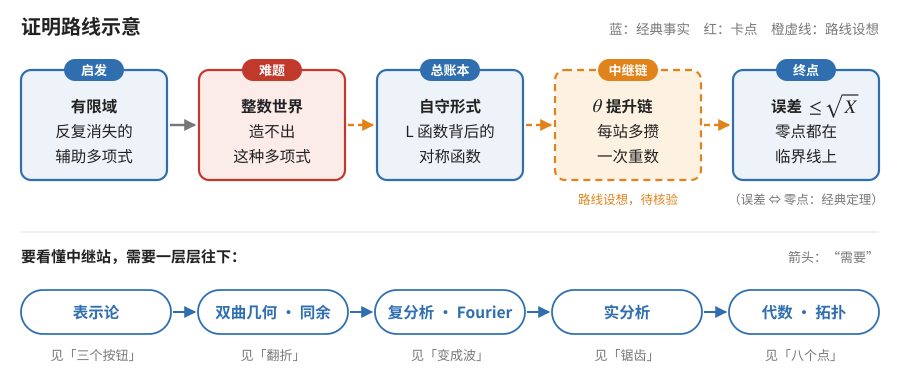

要看懂这些中继站，得先懂表示论；表示论操作的是双曲几何和整数铺成的瓦片；看懂瓦片，要靠复分析和 Fourier 分析；再往下是实分析的误差估计；最底下，是代数和拓扑。

这条依赖链太长了，抽象地往上爬一定会迷路。
所以我们找一个小到能手算、却会经过每一站的例子：**圆上的整数点**。

<!-- more -->

## 八个点

$5 = 1^2 + 2^2$。
在方格纸上画一个半径 $\sqrt5$ 的圆，它正好穿过 8 个整数点：

$$
(\pm1, \pm2),\quad (\pm2, \pm1)
$$

为什么恰好是 8 个？
不超过 5 的平方数只有 0、1、4，能凑成 5 的只有 $1+4$。
交换两个坐标、分别改变正负号，一共 $2 \times 2 \times 2 = 8$ 种。

换个角度看，这 8 个点是同一个点被“转 90 度”和“翻面”反复搬出来的。
这些动作可以组合，组合的结果还是这类动作，它们构成一个群（正方形的对称群，8 个元素）。
**这 8 个点，就是这个群的一个轨道。**

大一点的圆就不一定只有一个轨道了。
比如 $25 = 0^{2} + 5^{2} = 3^{2} + 4^{2}$，半径 5 的圆上有 $4 + 8 = 12$ 个点，分属两个轨道。
数点，就变成了数轨道、再把每个轨道的大小加起来。

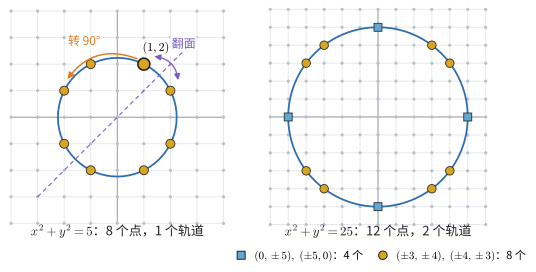

方格纸还有一种对称：整张纸往右或往上挪一格，看起来和原来一模一样。
既然处处重复，就只需要研究其中一格。
把这一格剪下来，左右两边粘起来，上下两边也粘起来，像贪吃蛇穿墙那样，从右边出去就从左边回来，它就成了一个**甜甜圈**（环面）。

后面我们会遇到一整片无穷多的瓦片，处理它们靠的就是这一招：只看一块，再把边粘起来。
代数管“怎么动”，拓扑管“怎么粘”，这是整条路线最底层的两样工具。

那么，一个大圆**里面**，一共有多少个点？

## 锯齿：数不准的边缘

### 高斯圆问题

把圆放大到半径 $\sqrt{X}$。
记 $r_2(n)$ 为半径平方恰好是 $n$ 的圆上的格点数（比如 $r_2(5) = 8$，$r_2(3) = 0$），圆里的点就是把更小的那些圆上的点全加起来：

$$
N(X) = \sum_{0 \le n \le X} r_2(n)
$$

每个格点占一个单位小方块，所以格点数大约就是面积 $\pi X$。
但只是大约。在像素屏上画过圆的人都知道：像素数约等于面积，误差全在锯齿状的边缘。

$$
N(X) = \pi X + E(X)
$$

边缘那一圈小方格大约有周长那么多，也就是 $\sqrt{X}$ 量级，所以 $|E(X)| = O(\sqrt{X})$。
这是高斯自己就知道的。

真实的误差要小得多。
1915 年 Hardy 证明了误差至少会时不时冲到 $X^{1/4}$ 那么大，于是数学家猜测：

$$
E(X) = O\!\left(X^{1/4 + \varepsilon}\right) \quad \text{对任意 } \varepsilon > 0
$$

这就是**高斯圆问题**。
一百多年来，指数从 $\frac12$ 被一点点往下压：Sierpiński 1906 年压到 $\frac13$，Huxley 2003 年压到 $\frac{131}{416} \approx 0.3149$，近年的纪录在 $0.3145$ 左右。
离 $\frac14$ 还差得远。

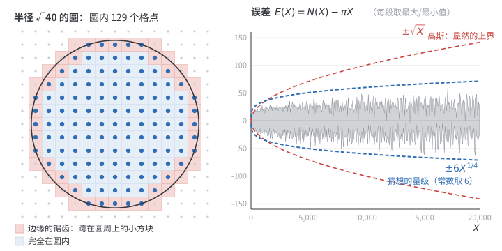

“误差到底能小到多少”——黎曼猜想对素数问的，正是同一类问题。
只不过素数那边要的是 $\sqrt{x}$，而且一百六十多年来同样没人证出来。

### 先把边缘磨平

要研究误差，先别让边缘那么锋利。
图形学里的抗锯齿，是给边缘像素按覆盖比例加权。
数学上也一样：把“圆内算 1、圆外算 0”的硬截止，换成一个平滑的权重函数。

为什么非要磨平？
因为下一步要做 Fourier 变换，而一个带硬边的函数，它的 Fourier 变换衰减得很慢，加起来甚至不绝对收敛。
平滑以后，变换衰减得很快，所有的求和、积分都可以放心交换次序。
代价是边缘那一圈被改动了，这部分要另外记账估计。
解析数论里大量的技术活，就花在“平滑带来的好处”和“记账的代价”之间的权衡上。

可误差到底有多大，还是没有答案。
要知道它，得看清边缘上那些点的起伏规律。

## 变成波

### Poisson 求和

工程里有一条熟悉的规律：**在时间上等间隔采样，频谱就会周期性地重复。**
它的数学本体叫 Poisson 求和公式：对足够好的函数 $f$，

$$
\sum_{n \in \mathbb{Z}} f(n) = \sum_{k \in \mathbb{Z}} \hat f(k), \qquad \hat f(\xi) = \int_{-\infty}^{\infty} f(x)\, e^{-2\pi i x \xi}\, dx
$$

在整数格点上把 $f$ 加起来，等于在“频率格点”上把它的 Fourier 变换加起来。
平面上一样成立，格点 $\mathbb{Z}^2$ 的频率格点还是 $\mathbb{Z}^2$。

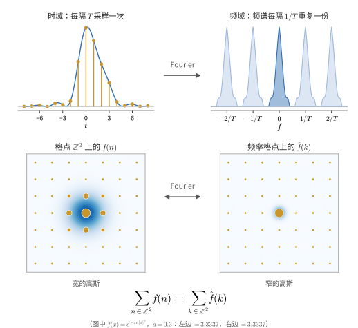

用它去看圆。
取 $f$ 为半径 $\sqrt{X}$ 的圆盘的指示函数（先不管收敛问题），它的二维 Fourier 变换可以用 Bessel 函数写出来：

$$
\hat f(\xi) = \frac{\sqrt{X}\, J_1\!\left(2\pi\sqrt{X}\,|\xi|\right)}{|\xi|}
$$

频率为零的那一项 $\hat f(0)$ 是圆盘面积 $\pi X$，**这就是主项**。
其余每个频率都贡献一道波。
利用 $J_1(z) \approx \sqrt{2/(\pi z)}\cos(z - 3\pi/4)$，再把同一个圆上的频率格点归到一起，就得到 Hardy 和 Voronoi 的公式：

$$
E(X) \approx \frac{X^{1/4}}{\pi} \sum_{n=1}^{\infty} \frac{r_2(n)}{n^{3/4}} \cos\!\left(2\pi\sqrt{nX} - \frac{3\pi}{4}\right)
$$

**格点，变成了波。**
注意每道波的振幅都带着 $X^{1/4}$，这就是 $\frac14$ 这个猜想指数的来源：
如果这些波的相位足够“随机”，彼此大量抵消，误差就停在 $X^{1/4}$ 附近；
合拍处互相加强，误差就更大。
误差有多大，取决于这些波抵消得有多干净。


这个形式和素数那边的显式公式如出一辙：主项加一串振荡的波。
区别在于，圆问题里波的频率 $\sqrt{n}$ 是已知的；素数那边，波的频率就是 ζ 零点的虚部，而它们的实部在哪，正是问题本身。

### 换成高斯权重

接下来换一种权重，把格点重新打包。
这次选钟形的高斯函数，因为**高斯函数的 Fourier 变换还是高斯**，算起来最方便。
先在一条直线上做，再平方回到平面。

要处理波就得用复数。
取一个复数 $\tau = u + iv$，把每个整数的平方写进复指数里：

$$
e^{\pi i n^2 \tau} = e^{-\pi v n^2} \cdot e^{\pi i u n^2}
$$

虚部 $v$ 给出衰减（一个高斯钟形），实部 $u$ 给出旋转的相位。
把所有项加起来，就是 **θ 函数**：

$$
\theta(\tau) = \sum_{n \in \mathbb{Z}} e^{\pi i n^2 \tau} = 1 + 2e^{\pi i \tau} + 2e^{4\pi i \tau} + 2e^{9\pi i \tau} + \cdots
$$

把这份清单乘以自己，指数两两相加，正好枚举所有“两个平方的和”：

$$
\theta(\tau)^2 = \sum_{m, n} e^{\pi i (m^2 + n^2)\tau} = \sum_{N \ge 0} r_2(N)\, e^{\pi i N \tau}
$$

指数为 5 的那一项，系数是 8，就是开头那 8 个点。
**一个数点问题，被打包成了一个函数。**
这种“把一串数编成一个函数的系数”的手法叫生成函数，是整个解析数论的基本功。

θ 函数有两件怪事。
第一，$v$ 必须为正，级数才收敛，所以 $\tau$ 只能待在复平面的上半部分。
第二，在 Poisson 求和的计算里，它还藏着一个意外的对称。

## 翻折：一个意外的对称

### 两个对称

θ 有一个平凡的对称：$\tau$ 加 2，所有指数 $\pi i n^2 \tau$ 都多出 $2\pi i n^2$，函数不变。这只是周期。

另一个对称一点也不平凡。
取 $f(x) = e^{-\pi t x^2}$（$t > 0$），它的 Fourier 变换是 $\hat f(\xi) = t^{-1/2} e^{-\pi \xi^2 / t}$。
把这一对代进 Poisson 求和，就得到

$$
\theta\!\left(\frac{i}{t}\right) = \sqrt{t}\; \theta(it)
$$

再用解析延拓推到整个上半平面：

$$
\theta\!\left(-\frac{1}{\tau}\right) = \sqrt{\frac{\tau}{i}}\; \theta(\tau)
$$

把 $\tau$ 换成 $-1/\tau$，函数只乘上一个简单的因子。
乘一个因子也算对称，就像地图换了比例尺：数值变了，但换算的规则没有乱。

这个等式在 $\tau = it$ 时有一个很直观的意思：
$t$ 很小时，$\theta(it)$ 是一个非常“胖”的高斯在整数点上的取值之和，差不多就是积分 $1/\sqrt{t}$；
等式说，这个近似的误差，恰好是一个非常“瘦”的高斯在整数点上的和。
**胖和瘦、时域和频域，被一个等式钉在了一起。**

### 整数矩阵与双曲瓦片

平移和翻折都能写成 $2\times2$ 整数矩阵，矩阵作用在 $\tau$ 上的方式是一个分式：

$$
\begin{pmatrix} a & b \\ c & d \end{pmatrix} \cdot \tau = \frac{a\tau + b}{c\tau + d}, \qquad
\tau + 2 \leftrightarrow \begin{pmatrix} 1 & 2 \\ 0 & 1 \end{pmatrix}, \quad
-\frac1\tau \leftrightarrow \begin{pmatrix} 0 & -1 \\ 1 & 0 \end{pmatrix}
$$

容易验证，两次分式变换的复合，对应矩阵的乘积。
这两个动作反复组合，又回到了“八个点”里那种群，只不过这次是无穷群。
它们在上半平面上铺出一片瓦片：越靠近实轴，瓦片看起来越小、越密。

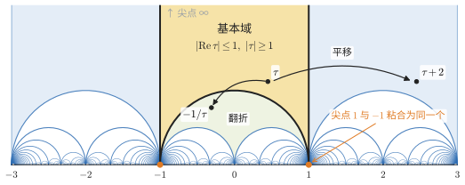

这里量距离用的不是普通的尺子，而是**双曲**的尺子：

$$
ds^2 = \frac{dx^2 + dy^2}{y^2}
$$

越靠近实轴，同样长的一段在双曲尺子下越长。
用它来量，这些越来越小的瓦片其实一样大；看起来弯曲的半圆，才是这里的“直线”。
分式线性变换恰好保持这把尺子，所以它们是双曲平面的“刚体运动”。

（顺带一提，Escher 那几幅鱼和天使铺满圆盘的版画，画的就是双曲平面的瓦片，只不过用的是圆盘模型。）

### 同余进场

并不是每个整数矩阵，θ 都守规则。
比如 $\tau$ 只加 1：$e^{\pi i n^2}$ 对奇数 $n$ 是 $-1$，奇数项全部变号，θ 就变了样；要加 2 才行。
可以证明，θ 守规则的矩阵恰好是那些除以 2 的余数为

$$
\begin{pmatrix} 1 & 0 \\ 0 & 1 \end{pmatrix} \quad\text{或}\quad \begin{pmatrix} 0 & 1 \\ 1 & 0 \end{pmatrix} \pmod 2
$$

的矩阵，它们组成的群叫 **θ 群**，在全体整数矩阵（$SL_2(\mathbb Z)$）里指数是 3。
不管数有多大，只看它除以某个数的余数，这就是初等数论里的**同余**。
这里看的是除以 2，后面还会用到除以 4。

要紧的是，这无穷多块瓦片并不各自独立：只要知道 θ 在一块瓦片上的值，其余瓦片上的值都由变换律决定。
所以只要研究一块，再把它的边按这些动作粘起来，就像在“八个点”里粘甜甜圈一样。
粘好的形状有两个“尖端”：一个伸向无穷远，另一个是 $1$ 和 $-1$ 粘在一起的那一点。自守形式的很多分析（比如增长条件）都发生在尖端上。

Poisson 求和算出了这条变换律。
可它背后，是怎样一整套作用？

## 三个按钮：对称从哪里来

### 高斯脉冲的三个按钮

答案藏在高斯脉冲里。
雷达和通信常用高斯脉冲做脉冲成形，就是因为它的 Fourier 变换还是高斯，在时域和频域里同样集中。

θ 函数的每一项，都是一个高斯脉冲 $g_\tau(x) = e^{\pi i \tau x^2}$ 在整数点上的取值。
$\tau$ 给这一族脉冲编了号；$\tau$ 的虚部必须为正，脉冲才会衰减。
**这就是 θ 只能待在上半平面的原因。**

现在对这个脉冲按三个按钮：

1. **chirp（啁啾）**：乘上一个二次相位 $e^{\pi i b x^2}$。它和高斯的指数一合并，$\tau$ 就加上 $b$：
$$
e^{\pi i b x^2} \cdot e^{\pi i \tau x^2} = e^{\pi i (\tau + b) x^2}
$$
2. **拉伸**：把时间轴拉伸 $a$ 倍，$g_\tau(ax) = g_{a^2\tau}(x)$，$\tau$ 按倍数缩放。
3. **Fourier 变换**：直接计算可得
$$
\widehat{g_\tau} = \left(\frac{\tau}{i}\right)^{-1/2} g_{-1/\tau}
$$
$\tau$ 变成了 $-1/\tau$，还多了一个因子。


信号上的操作，变成了上半平面上的移动；**按钮怎么组合，矩阵就怎么相乘。**
把一个群的动作变成函数上的线性操作，而且组合规则保持不变，这就是**表示论**。
这一套具体的实现，叫 **Weil 表示**（André Weil，不是写《群论与量子力学》的那位 Hermann Weyl）。
Fourier 变换只是其中的一个按钮。

细心的读者会注意到 $(\tau/i)^{-1/2}$ 里的平方根。
平方根有两个分支，按钮组合时会带出一个正负号的歧义：转一整圈回来，可能差一个负号。
所以严格说，Weil 表示表示的不是 $SL_2(\mathbb R)$ 本身，而是它的一个“双层覆盖”，叫 metaplectic 群。
这和电子自旋要转两圈才回到原状，是同一类现象。
θ 的权重是“半整数” $\frac12$，根源就在这里。

### 从连续到格点

按钮是作用在 $\mathbb{R}$ 上的连续函数上的，θ 却是格点上的求和，中间还差一步。
把 θ 写成一个内积会看得更清楚：

$$
\theta(\tau) = \sum_{n} g_\tau(n) = \left\langle \sum_{n} \delta_n,\; g_\tau \right\rangle
$$

$\sum_n \delta_n$ 是整数格点上的一排冲激，信号处理里叫 Dirac 梳。
Poisson 求和公式说的正是：**Dirac 梳的 Fourier 变换还是它自己。**
chirp 按钮 $e^{\pi i b x^2}$ 在 $b = 2$ 时，在每个整数点上都等于 1，所以也不改变 Dirac 梳。
于是凡是由“Fourier”和“chirp 2”组合出来的按钮序列，都让 Dirac 梳保持不变，

$$
\langle \delta_{\mathbb Z},\; \text{按钮}(g_\tau) \rangle = \langle \text{按钮}^{-1}(\delta_{\mathbb Z}),\; g_\tau \rangle = \langle \delta_{\mathbb Z},\; g_\tau \rangle
$$

而按钮作用在 $g_\tau$ 上，只是把 $\tau$ 搬到另一处、再乘个因子。
θ 的变换律，就这样从“Dirac 梳在一组按钮下不变”里掉了出来。
那组按钮，正是 θ 群。

这个视角很重要：**θ 函数 = 一个对称的分布（格点）与一族对称的测试函数（高斯）之间的配对。**
后面的 θ 核、θ 提升，都是这个配对的放大版。

### 第二组作用：转动

回到要数的点。
数圆上的点，用的是 θ 的平方。
换成脉冲的说法：横着放一个钟形，竖着放一个钟形，两者相乘，

$$
g_\tau(m)\, g_\tau(n) = e^{\pi i \tau m^2} \cdot e^{\pi i \tau n^2} = e^{\pi i \tau (m^2 + n^2)}
$$

乘出来的是一个圆形的高斯团，它的高度只取决于到原点的距离。
在每个格点上取它的值再相加，就是 $\theta^2$；同一个圆上的格点到原点一样远，取到的值也一样，所以这个和数的正是每个圆上有几个点。

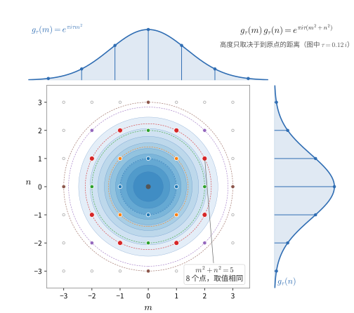

圆形的高斯团还可以转动。
平面上的 Fourier 变换、chirp $e^{\pi i b (x^{2} + y^{2})}$ 和拉伸都与转动交换：先按按钮再转，和先转再按按钮，结果一样。
所以，**在平面函数这同一个空间里，住着两组互不干扰的作用**：一组是转动群 $O(2)$，另一组是那三个按钮生成的 $SL_2$。

不过要注意，只有转 90 度这样的角度，才能保住整数格子。
连续的转动会把格点转到非整数的位置上去，所以落到格点求和时，只剩下“八个点”里那 8 个动作。

这种“两组作用在同一空间里互为对方的中心化子”的结构，Roger Howe 称之为**对偶对**（dual pair）。
$(O(2), SL_2)$ 是最小的例子。先记住它，后面会用到。

## 镜子：有对称的函数，和它背后的素数

### 自守形式

对称既然来自一套普遍的规则，就一定还有别的函数遵守同样的规则。

在上半平面那组整数矩阵的作用下，按固定规则变化（乘一个形如 $(c\tau+d)^k$ 的因子）、并且增长受控制的全纯函数，叫**模形式**；$k$ 叫它的权。
θ 是权 $\frac12$ 的，$\theta^2$ 是权 1 的。
把“上半平面上的整数矩阵”换成更一般的群和空间，就得到更一般的**自守形式**。
正弦波平移一个周期后重合，是它最简单的影子。

模形式是一种约束极强的东西：给定权和群，满足条件的模形式组成一个有限维的线性空间。
这意味着，只要两个模形式的前几项系数相同，它们就整个相同。
大量看似神奇的恒等式，都是这么证出来的：先证明两边都是同一个有限维空间里的模形式，再比较前几项。

### 算术指纹

$\theta^2$ 的系数有一个特别的性质。
除以 4 以后，两个互素的数相乘，系数也相乘：

$$
\frac{r_2(mn)}{4} = \frac{r_2(m)}{4} \cdot \frac{r_2(n)}{4}, \qquad \gcd(m, n) = 1
$$

所以只要知道它在素数和素数的幂上的值，就知道了全部。

再看奇素数 $p$，半径平方为 $p$ 的圆上有几个点，结果简单得惊人：
$p$ 除以 4 余 1，$r_2(p)/4 = 2$；余 3，$r_2(p)/4 = 0$。
这就是费马的二平方定理：奇素数能写成两个平方之和，当且仅当它除以 4 余 1。

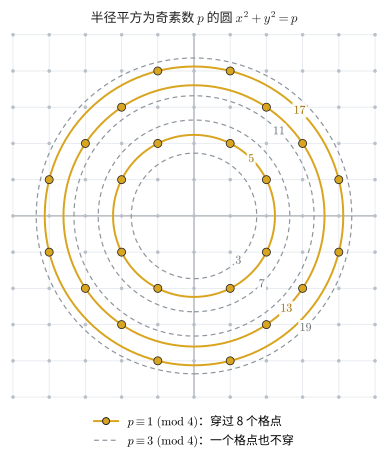

为什么会有这种可乘性？
有一族叫 **Hecke 算子** 的操作 $T_p$，作用在整个模形式空间上，并且彼此交换。
$\theta^2$ 所在的空间恰好是一维的，所以 $T_p$ 作用在它上面只能是乘一个数，这个数正是素数 $p$ 处的读数。
可乘性就是“同时是所有 $T_p$ 的特征向量”的直接后果。
一个形式在每个素数处的读数，像一枚**算术指纹**。

可乘性是 $\theta^2$ 这类特殊形式的性质，不是所有模形式都有。
一般的空间里需要先找出 Hecke 算子的公共特征向量，那些特征向量才有可乘的系数。

### 打包成 L 函数

这串系数还能换一种方式打包：不用 $e^{\pi i n\tau}$，改用 $n^{-s}$。
秘密藏在约数里。
定义一个记号 $\chi_{-4}(n)$：$n$ 除以 4 余 1 记 $+1$，余 3 记 $-1$，偶数记 0。
Jacobi 的二平方定理说：

$$
\frac{r_2(n)}{4} = \sum_{d \mid n} \chi_{-4}(d)
$$

5 的约数 1 和 5 都记 $+1$，和是 2；3 的约数 1 和 3 一正一负，和是 0。
因为右边是“约数和”，打包以后正好裂成两个函数的乘积：

$$
\sum_{n \ge 1} \frac{r_2(n)}{n^s} = 4\, \zeta(s)\, L(s, \chi_{-4})
$$

一个是 ζ 函数，另一个是 **L 函数**：

$$
L(s, \chi_{-4}) = 1 - \frac{1}{3^s} + \frac{1}{5^s} - \frac{1}{7^s} + \cdots = \prod_{p} \frac{1}{1 - \chi_{-4}(p)\, p^{-s}}
$$

它就是给 ζ 的每一项配上 $\chi_{-4}$ 这串记号作系数。
它和 ζ 是一家人：一样能拆成每个素数一项的乘积（Euler 乘积，这一步要用到 $\chi_{-4}$ 的可乘性），一样有自己的零点。
可以把它看成**带着算术记号的 ζ**。

这里有一个很漂亮的彩蛋。
$s = 1$ 时，$L(1, \chi_{-4}) = 1 - \frac13 + \frac15 - \cdots = \frac{\pi}{4}$，这是 Leibniz 级数。
而 $r_2(n)$ 的平均值，按上面的乘积公式算，等于 $4 L(1, \chi_{-4}) = \pi$。
这和圆的面积 $\pi X$ 完全吻合：**Leibniz 级数和高斯圆问题，说的是同一件事。**

我们出发时只想数点，现在已经站在黎曼猜想的门口。

### Mellin 变换：从翻折到镜像

从 $\tau$ 走到 $s$，要经过一次积分变换，叫 **Mellin 变换**。
对 θ 来说，沿虚轴 $\tau = it$ 积分：

$$
\int_0^\infty \frac{\theta(it) - 1}{2}\, t^{s/2}\, \frac{dt}{t} = \sum_{n \ge 1} \int_0^\infty e^{-\pi n^2 t}\, t^{s/2}\, \frac{dt}{t} = \pi^{-s/2}\, \Gamma\!\left(\frac{s}{2}\right) \zeta(s)
$$

把积分从 $t = 1$ 处劈成两半，在 $(0, 1)$ 那半用翻折 $\theta(i/t) = \sqrt{t} \theta(it)$ 换成 $(1, \infty)$ 上的积分，就会发现右边记为 $\xi(s)$ 的东西满足

$$
\xi(s) = \xi(1 - s)
$$

“翻折”里的那个对称，**变成了 $s$ 和 $1 - s$ 之间的镜像对称**，而临界线 $\mathrm{Re}(s) = \frac12$ 正是这面镜子。
黎曼当年就是用 θ 得到 ζ 的这种对称的。
同样的手续作用在 $\theta^2$ 上，给出 $\zeta(s) L(s, \chi_{-4})$ 乘上 $\pi^{-s}\Gamma(s)$ 之后的镜像对称。

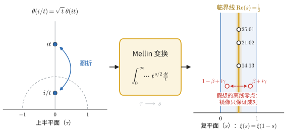

但要小心：**镜像只保证零点左右成对出现，并不保证它们都落在镜面上。**
它们是不是全在镜面上，正是黎曼猜想要证明的事。

### 问题化归

那怎么证明呢？
回到开头那幅画：每个零点贡献一道波 $x^\rho = x^\beta e^{i\gamma\log x}$。
零点越偏向镜子右边（$\beta > \frac12$），振幅涨得越快；左边的零点，镜像过去就在右边。
所以只要证明误差始终不超过平方根，就证明了零点都不离开镜面。

**问题于是变成：怎样把误差压到平方根？**

### 朗兰兹的远景

到这里，副标题里的朗兰兹纲领可以登场了。

我们刚刚看到一个具体的现象：一个模形式（$\theta^2$），背后站着一个 L 函数（$\zeta \cdot L(s,\chi_{-4})$），模形式的对称变成了 L 函数的镜像对称。
朗兰兹纲领把这个现象提升成一个宏大的猜想：

- 数论里自然出现的各种 L 函数（来自素数、来自方程的解数、来自 Galois 表示……），**每一个背后似乎都站着一个自守形式**；
- 不同群上的自守形式之间，存在着保持 L 函数的“传递”关系，叫**函子性**（functoriality）。

这是纲领与猜想，大部分还没被证明。
怀尔斯证明费马大定理，核心就是证明了其中一小块：某类椭圆曲线的 L 函数背后确实站着模形式。

不过，在眼前这个例子里，模形式、L 函数、对称都已经齐了，零点问题还是没有解决。
**真正缺的，是足够强的数量估计。**

每一步，都是因为上一步卡住了。
自守世界不止一个：圆的转动是一套对称，上半平面的矩阵是另一套。
能不能把一边的信息，送到另一边？

## 提升：把对称送到另一边

### θ 核

回到“三个按钮”结尾那两组作用：一组转动平面，一组移动上半平面。
能同时听懂两边的对象，叫 **θ 核**。
它带着两边的变量 $\Theta(g, h)$，固定一边，另一边就留下一个函数；前面的 θ，就是最简单的一种。

### 手算一次提升

用 $\theta^2$ 数圆上的点时，每个格点都只算 1：半径 $\sqrt5$ 的圆上有 8 个点，系数就是 8。
现在换一种算法，按方向加权：点 $(x, y)$ 不再算 1，而是算 $(x + iy)^k$。
同一个圆上，方向转一圈，相位就转 $k$ 圈。

天线阵里有一个熟悉的类比：给每个阵元按方向加相位权重，就能形成指向某个方向的波束。

如果 $k$ 不是 4 的倍数，“八个点”里转 90 度得到的那四个点，相位分别差 $i^k$，加起来是

$$
z^k \left(1 + i^k + i^{2k} + i^{3k}\right) = 0
$$

正好抵消成零。

$k = 4$ 就不一样了。
$(1+2i)^4 = -7 - 24i$，$(1-2i)^4 = -7 + 24i$，八个点里各有四个落在这两个值上：

$$
\sum_{x^2 + y^2 = 5} (x + iy)^4 = 4(-7-24i) + 4(-7+24i) = -56
$$

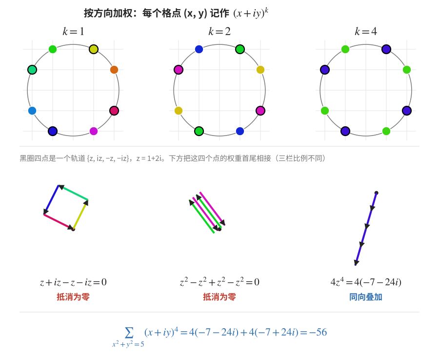

把每个圆的加权和像在“变成波”里那样打包，

$$
\sum_{x, y} (x + iy)^4\, e^{\pi i (x^2 + y^2) \tau}
$$

得到的仍是一个模形式（权变成 $5$），指数 5 的系数从 8 变成了 $-56$。
之所以还是模形式，是因为 $(x+iy)^k$ 是一个**调和多项式**（满足 Laplace 方程），它和 Fourier 变换、高斯函数配合得恰到好处。
这就是一次从圆到模形式的提升，最小的 θ 提升。

（这个权 5 的形式有自己的 L 函数，是 Gauss 整数环 $\mathbb Z[i]$ 上的一个 Hecke L 函数。它也是一个“带复数相位的”素数计数。）

所以，**提升不是无损传送**。
每次都要先问：结果消失了吗？

### 一般的形状

一般来说，提升就是把一边的对象 $f$ 和 θ 核配对，再积分，在另一边得到一个新对象：

$$
F(h) = \int_{[G]} f(g)\, \Theta(g, h)\, dg
$$

（这是概念示意；实际定义里，积分区域、测度和 θ 核的选取都有严格条件。）
积分要收敛，结果的大小也要估计。

为什么要绕这一步？
因为同一份信息，到了另一边可能更好处理：这边只是加权数点，那边却有整套对称和系数规律可用。

关于提升，有几个经典工具值得一提：

- **Rallis 内积公式**：提升结果的“大小”（Petersson 内积）等于某个 L 函数的特殊值乘上一些局部因子。所以“提升是不是零”和“某个 L 值是不是零”紧紧绑在一起。
- **跷跷板（seesaw）**：两对对偶对 $(G_1, H_1)$、$(G_2, H_2)$ 如果交叉包含，就可以把“一边提升再限制”的积分换成“另一边限制再提升”。这是计算周期积分的主要手段。
- **Siegel–Weil 公式**：θ 核对一个群整体积分，得到一个 Eisenstein 级数，相当于“平均意义下的点数”。

θ 对应是朗兰兹函子性里为数不多的、能被具体构造出来的实例之一。

### 中继链（路线设想）

把圆换成更高维的二次型，把转动群换成更大的群（比如酉群），提升就能一站接一站进行：上一站的输出，就是下一站的输入。

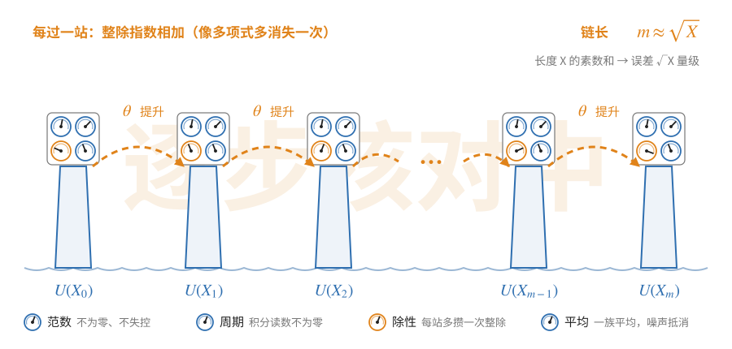

下面这段是笔者对 Alpoge 声明的转述，属于路线设想。

在有限域里，是一个反复消失的多项式卡住了点数。
这条路线设想，每过一站，某些量就多被整除一次，就像多项式又多消失了一次。
声明里的时间线写道：在**全定号酉群**之间做迭代 θ 提升 $U(X_0) \to U(X_1) \to \cdots \to U(X_m)$，赢得重数 $m$。

然后是那句被 Alpoge 称为“足以让数学家从椅子上摔下来”的话：

> 对长度为 $X$ 的 von Mangoldt 和，考虑到每一次 θ 提升都在模拟一次重数，Claude 建议的提升链长度是 $\sqrt{X}$。（可它还能是什么呢？）

还记得 Stepanov 方法里，最划算的重数是 $\sqrt{q}$ 吗？
在有限域里，重数 $\sqrt q$ 换来误差 $\sqrt q$；
在整数里，长度为 $X$ 的素数和，要 $\sqrt X$ 站提升攒出 $\sqrt X$ 重，换来误差 $\sqrt X$。
**两边的数字对得严丝合缝。**
笔者第一次读到这里时，也有一种“原来如此”的眩晕感。

### 四块仪表

前面已经看到，提升不是无损传送：一站送过去的东西，可能变成零，也可能大得失控。
所以每过一站，都要读几块仪表，确认送到的东西还在，而且大小合适：

- **范数**：量的是大小，既不能为零，也不能太大。Rallis 内积公式把它连到 L 值上。
- **周期**：一种积分读数（不是“翻折”里的那个周期），比如声明里提到的 Gan–Gross–Prasad 周期、Bessel 周期。读数不为零，就说明这一站没把东西弄丢。
- **除性**：看结果被什么整除，记下的正是每一站多攒下的那一次整除。声明里说，这部分要用到 Chowla–Selberg 公式、Weyl 和 Siegel 质量公式。
- **平均**：把一族对象（比如一族 Hecke 特征）放在一起平均，让各自的噪声互相抵消，误差才有希望压到平方根。

声明的时间线里还出现了一长串名词：Stepanov 行列式、Bost 斜率不等式、Iwasawa 塔、相对迹公式、弱化版的 Vandiver 猜想、Behrend 构造……
攒起来的“重数”到底是什么，为什么能一站站攒起来，又怎样换成误差的界，这些笔者都无法展开，也无力判断。
**这里也正是最需要核验的地方。**

## 赛跑：回到圆上

### 两队素数

走完这一圈，回到出发的那个圆。

能写成两个平方和的奇素数，是除以 4 余 1 的那些。
把奇素数按余 1、余 3 分成两队，一路数下去，看它们赛跑：

| 素数 | 3 | 5 | 7 | 11 | 13 | 17 | 19 | 23 | 29 | 31 |
|---|---|---|---|---|---|---|---|---|---|---|
| 余 1 队 | 0 | 1 | 1 | 1 | 2 | 3 | 3 | 3 | 4 | 4 |
| 余 3 队 | 1 | 1 | 2 | 3 | 3 | 3 | 4 | 5 | 5 | 6 |

余 3 的一队常常稍微领先。
这个现象叫**切比雪夫偏差**，1853 年切比雪夫在给 Fuss 的信里就注意到了。
余 1 的一队第一次反超，要等到 $x = 26861$。
Rubinstein 和 Sarnak 在 1994 年证明（假设 GRH 和零点虚部线性无关），余 3 队领先的“对数密度”约为 99.59%。

但长远来看，两队人数之比会趋于一比一，这在 1896 年就已经证明了（算术级数中的素数定理）。

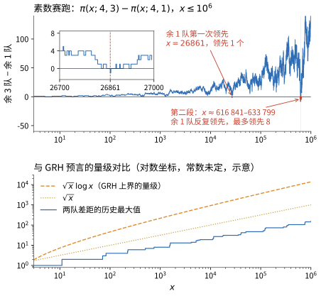

### L 函数管差距

还记得 $\chi_{-4}$ 这个正 1、负 1 的记号吗？
沿着素数把它加起来，正好是两队的差距：

$$
\sum_{p \le x} \chi_{-4}(p) = \pi(x; 4, 1) - \pi(x; 4, 3)
$$

所以管这场比赛的，是 $L(s, \chi_{-4})$：**ζ 的零点管素数总数，L 的零点管两队差距。**
道理和显式公式一样，只不过把 ζ 换成了 L。

黎曼猜想说的是 ζ；推广到 L 这样的函数，就是**广义黎曼猜想（GRH）**。
如果它对 $L(s, \chi_{-4})$ 成立，那么数到 $x$ 为止，两队的差距不超过 $\sqrt{x}\log x$ 的常数倍。
这比“一比一”要强得多。

从 8 个能数出来的点出发，我们一路用上了误差、频率、对称、表示、自守形式和 θ 提升，走到了 GRH 的一个具体面孔前。
**每一座桥，都是因为上一座桥不够长。**

当然，看懂一个具体后果，不等于理解全部 GRH，更不等于核验了开头那份证明。
如果这条路线最终被证实，它就是数学家和机器共同搭起的一座桥。
Alpoge 在声明里说，在最后冲线的那一段，Claude 远远跑在了他前面：

> No, Claude flew, and danced, and sparkled near that finish line.

## 奇观：什么才算真正的奇观

视频的最后一章，是一个小小的反转。
讲那部片子的旁白，自称“也是一个 Claude”。
从读那份声明开始，到写下每一句旁白、设计每一个画面，都是 Claude 和笔者一起完成的[^making]。
下面这一段的观点，大体来自片中“它”的那段独白。

### 两种证明

有限域上的黎曼猜想，有两种证明。

第一种来自 Stepanov 和 Bombieri，就是前面那个反复消失的多项式。
这个论证巧妙而初等，确认了结论，却没有说明**为什么**。

第二种来自 Grothendieck 和 Deligne（1974）。
它改变了看问题的方式：为曲线造出一种新的空间，叫**上同调**，让 Frobenius 这个操作在上面作用。
曲线的 ζ 函数，就是 Frobenius 在上同调上的特征多项式；零点就是它的特征值的倒数。
黎曼猜想变成：这些特征值的绝对值全都相同，都在半径为 $\sqrt q$ 的圆上。
零点为什么在线上，不再是费力估计出来的不等式，而成了结构的必然。

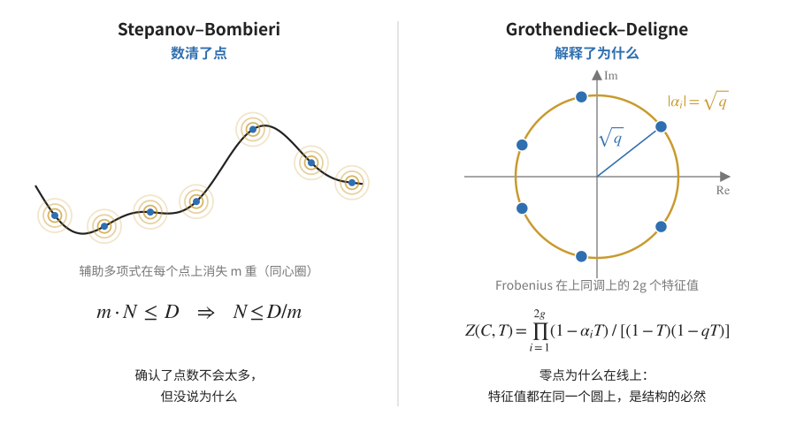

按 Alpoge 的描述，新路线属于第一种：Alpoge 明说这个论证是 Stepanov 方法的后代，一串 θ 提升扮演的是“反复消失”里的重数。
可整数没法求导，重数很难定义，“为什么”仍然悬而未决。
由此，有三个值得期待的方向。

### 三个方向

**第一，谱的解释。**
Hilbert 和 Pólya 猜想，ζ 的零点是某个算子的特征值；如果这个算子是自伴的（类似量子力学里的哈密顿量），它的特征值都是实数，零点就自动落在临界线上。
1972 年，Montgomery 在普林斯顿高等研究院喝下午茶时，向 Dyson 描述了自己算出的零点对关联函数；Dyson 立刻认出，那正是随机厄米矩阵（GUE）特征值的对关联。
后来 Odlyzko 用海量数值计算验证了这一点。
新证明若能引出这个算子，哪怕只是一个影子，就有了谱的解释。

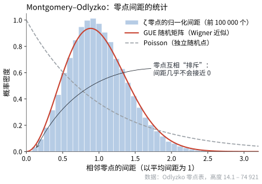

**第二，统一的理由。**
据称这个论证能推广到广义、乃至扩展黎曼猜想[^erh]。
一个办法对一整族 L 函数同时有效，背后很可能有共同的结构；找出它，就是统一的理由。

**第三，补全一本字典。**
在有限域一边，曲线、上同调、Frobenius 和 ζ 函数之间有一本完整的对照字典；到了整数一边，上同调和 Frobenius 那几页还是空的：

| 函数域（有限域上的曲线） | 数域（整数） |
|---|---|
| 曲线 $C / \mathbb{F}_q$ | $\mathrm{Spec}(\mathbb{Z})$ |
| ζ 函数 $Z(C, T)$ | 黎曼 ζ 函数 |
| 上同调 $H^{1}(\overline{C})$ | **？** |
| Frobenius | **？** |
| 特征值在 $\lvert z \rvert = \sqrt q$ 上 | 零点在 $\mathrm{Re}(s) = \frac12$ 上 |

一元域 $\mathbb{F}_1$、Connes 的非交换几何，都在尝试补写这两格。
如果“整数上的重数”能被说清楚，它也许就是其中缺失的一个词条。
有趣的是，Alpoge 在声明的脚注里也提到，自己想过要多努力才能争取到某种 $\mathbb F_1$。

### 真正的奇观

所以，真正的奇观，也许不只是机器写出了一份证明。
而是有一天，我们从实在的极高之处得到了一个洞察，从那里眺望这条长长的链，零点为什么都在那条线上，成了一目了然的事实。

Alpoge 自己的直觉也是这样：他说这个论证现在长得离谱，但它“将被大幅简化，很可能很快”。
到那时，奇迹就不只是被见证，而是被理解。

虽然我们还没有走到桥的尽头，但一路读到这里的你，也算从远处见证了这个奇迹。

---

**参考资料**

- Levent Alpoge, *remark*, [alpo.ge/remark.pdf](https://alpo.ge/remark.pdf)（以及 Lean 形式化代码 alpo.ge/lean.tar.gz.part01–14）
- E. Bombieri, *Counting points on curves over finite fields (d'après S. A. Stepanov)*, Séminaire Bourbaki, 1973
- P. Deligne, *La conjecture de Weil. I*, Publ. Math. IHÉS 43, 1974
- H. Iwaniec, E. Kowalski, *Analytic Number Theory*, AMS, 2004（第 5 章显式公式，第 11 章 Stepanov 方法）
- S. Kudla, *Notes on the local theta correspondence*；*Seesaw dual reductive pairs*, 1984
- M. Rubinstein, P. Sarnak, *Chebyshev's bias*, Experimental Math. 3, 1994
- H. Montgomery, *The pair correlation of zeros of the zeta function*, 1973

[^mangoldt]: $\Lambda$ 叫 von Mangoldt 函数。用 $\psi(x)$ 代替 $\pi(x)$，相当于给每个素数 $p$ 加权 $\log p$，再顺手把素数的幂也算进来。两者可以轻松互相换算，但 $\psi$ 的公式干净得多。Alpoge 声明里说的“长度为 X 的 von Mangoldt 和”就是它。
[^making]: 视频的旁白稿、分镜、Manim 和 three.js 动画、配音（克隆音色的 TTS）、配乐（AI 生成）以及片头的版画风格画面，都是在 Claude Code 里和 Claude 协作完成的。这篇博客的初稿也一样。至于它算不算“旁白自己出来说话”，就留给读者判断了:)
[^erh]: 扩展黎曼猜想（ERH）指的是对数域的 Dedekind ζ 函数的黎曼猜想。名称用法并不统一，有时 GRH、ERH 混用。声明里说 GRH 已经覆盖，ERH 则“有更多时间的话”也有望拿下。
